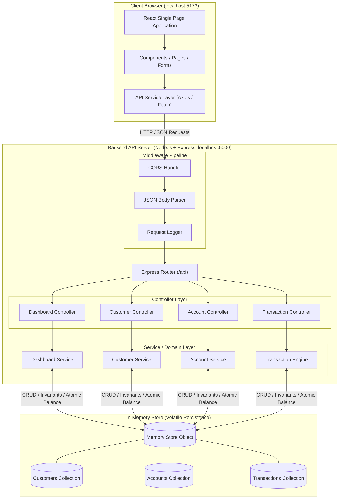
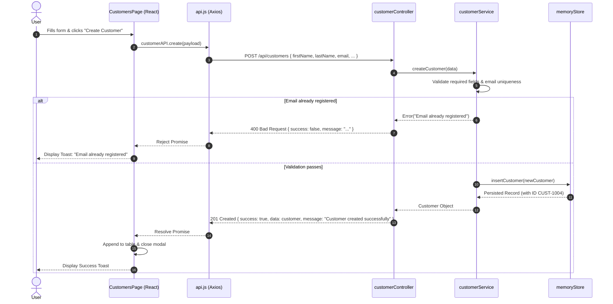
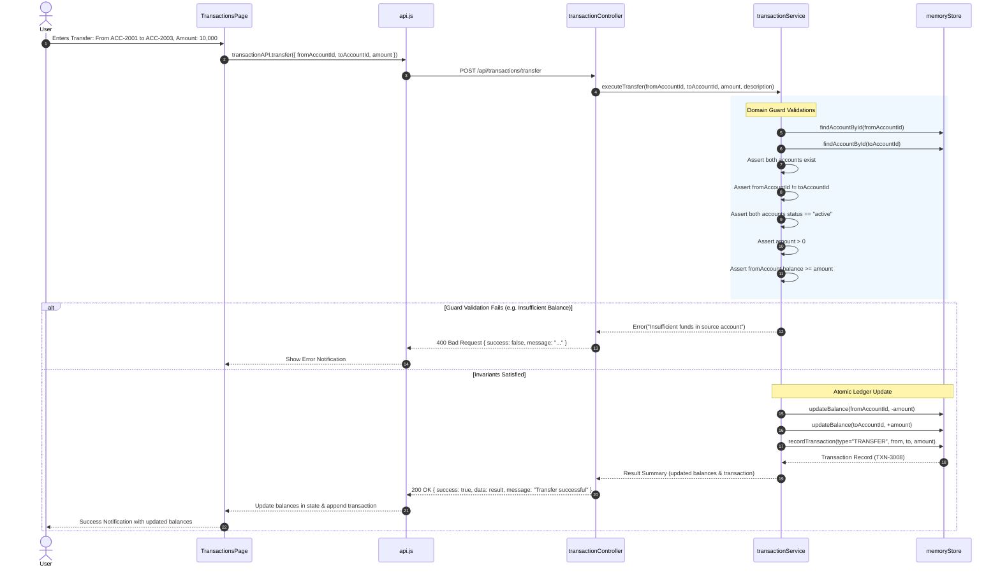

# System Architecture - CoreBanking Sandbox

> **Project ID:** PST_PD_153  
> **System:** CoreBanking Sandbox (Educational Core Banking Platform)  
> **Architectural Pattern:** Layered Client-Server Architecture (SPA + RESTful API + In-Memory Store)

---

## 1. System Overview

CoreBanking Sandbox models a modern retail core banking engine stripped of legacy monolithic complexity. The system adopts a decoupled, multi-tier architectural style:
1. **Presentation Tier:** A responsive Single Page Application (SPA) built using React 18, Vite, and Tailwind CSS.
2. **Application Tier:** An asynchronous Node.js Express REST API orchestrating business validation, routing, and controller dispatching.
3. **Domain & Data Tier:** An in-memory ledger and repository layer maintaining relational integrity between Customer entities, Bank Account ledgers, and Transaction journals.

---

## 2. End-to-End Architecture Diagram

### High-Level Topology (Mermaid)



### ASCII Structural Diagram

```
+-----------------------------------------------------------------------------------------+
|                                    CLIENT TIER                                          |
|                                                                                         |
|   +-----------------------+     +-----------------------+     +---------------------+   |
|   | Pages (Views)         |     | Shared Components     |     | Client Services     |   |
|   | - DashboardPage       | <-> | - Navbar, Sidebar     | <-> | - api.js            |   |
|   | - CustomersPage       |     | - StatCard, Modal     |     | - Axios Client      |   |
|   | - AccountsPage        |     | - TransactionTable    |     | - Error Interceptor |   |
|   | - TransactionsPage    |     | - StatusBadge         |     +----------+----------+   |
|   | - BalanceInquiryPage  |     +-----------------------+                |              |
+---+-----------------------+----------------------------------------------|--------------+
                                                                           | HTTP/REST
                                                                           v
+--------------------------------------------------------------------------|--------------+
|                                  APPLICATION TIER                        |              |
|                                                                          |              |
|   +----------------------------------------------------------------------v----------+   |
|   | Express HTTP Pipeline: cors() -> express.json() -> reqLogging -> /api routers   |   |
|   +--------------------------------------+------------------------------------------+   |
|                                          |                                              |
|            +-----------------------------+-----------------------------+                |
|            |                             |                             |                |
|   +--------v--------+           +--------v--------+           +--------v--------+       |
|   | Customer Routes |           | Account Routes  |           | Tx Routes       |       |
|   | & Controller    |           | & Controller    |           | & Controller    |       |
|   +--------+--------+           +--------+--------+           +--------+--------+       |
|            |                             |                             |                |
|   +--------v--------+           +--------v--------+           +--------v--------+       |
|   | CustomerService |           | AccountService  |           | TxService       |       |
|   | - email format  |           | - balance rule  |           | - debit / credit|       |
|   | - active acc ck |           | - status rules  |           | - atomic locks  |       |
|   +--------+--------+           +--------+--------+           +--------+--------+       |
|            |                             |                             |                |
+------------|-----------------------------|-----------------------------|----------------+
             |                             |                             | Direct Memory
             v                             v                             v Access
+-----------------------------------------------------------------------------------------+
|                                  IN-MEMORY REPOSITORY                                   |
|                                                                                         |
|   +-----------------------+     +-----------------------+     +---------------------+   |
|   | customers = [ ... ]   |     | accounts = [ ... ]    |     | transactions = [...]|   |
|   | - id (CUST-xxxx)      |     | - id (ACC-xxxx)       |     | - id (TXN-xxxx)     |   |
|   | - firstName, lastName |     | - customerId (FK)     |     | - type (DEP/WDR/TRF)|   |
|   | - email (Unique)      |     | - accountType         |     | - amount, balance   |   |
|   | - phone, address, dob |     | - balance (Decimal)   |     | - timestamp         |   |
|   | - createdAt           |     | - status (ACT/INA/FRZ)|     | - description       |   |
|   +-----------------------+     +-----------------------+     +---------------------+   |
+-----------------------------------------------------------------------------------------+
```

---

## 3. Frontend Architecture

The frontend is structured according to the Single Responsibility Principle, separating layout presentation, state lifecycle, and external network interactions.

### Directory Layout
```text
frontend/src/
├── main.jsx              # Bootstraps the React DOM tree
├── App.jsx               # Layout scaffold, routing, and notifications
├── index.css             # Tailwind CSS directives & global resets
├── components/           # Reusable stateless and composite widgets
│   ├── Navbar.jsx        # Top header with time, branding, and system status
│   ├── Sidebar.jsx       # Navigation drawer with route icons
│   ├── StatCard.jsx      # Reusable KPI card with trend & icon
│   ├── Modal.jsx         # Accessible modal wrapper for dialogs/forms
│   ├── StatusBadge.jsx   # Visual chip for Active/Inactive/Frozen tags
│   └── Alert.jsx         # Toast & inline message feedback banners
├── pages/                # Screen-level views
│   ├── DashboardPage.jsx # System overview, metrics, charts, quick actions
│   ├── CustomersPage.jsx # Customer list, creation drawer, edit modal
│   ├── AccountsPage.jsx  # Account cards, status toggle, open account
│   ├── TransactionsPage.jsx # Filterable audit ledger with pagination
│   └── BalanceInquiryPage.jsx # Dedicated quick balance lookup widget
├── services/
│   └── api.js            # Axios instance with centralized error handling
└── hooks/
    └── useFetch.js       # Custom asynchronous data fetcher hook
```

### Component Hierarchy & State Strategy
- **Shared App Layout:** `App.jsx` houses the persistent frame (`Sidebar`, `Navbar`, and `<main>` viewport).
- **Page-Level State:** Each page manages its local operational states (e.g., loading spinners, search filters, form validation errors, pagination limits).
- **Communication Bridge (`api.js`):** Encapsulates all REST calls into clean semantic functions:
  ```javascript
  customerAPI.getAll()
  accountAPI.updateStatus(id, status)
  transactionAPI.transfer({ fromAccountId, toAccountId, amount })
  ```
  This isolates UI components from low-level HTTP client details.

---

## 4. Backend Architecture

The backend implements a classic layered architectural pattern (`Routes -> Controllers -> Services -> Store`), enforcing separation of concerns.

```text
HTTP Request
     │
     ▼
[routes/xxxRoutes.js]        ── Handles URI pathing and maps HTTP verbs to controllers
     │
     ▼
[controllers/xxxCtrl.js]     ── Validates request payload structure, extracts params,
     │                          formats standard JSON responses ({ success, data, message })
     ▼
[services/xxxService.js]     ── Enforces banking business rules, invariants, validation logic
     │
     ▼
[store/memoryStore.js]       ── Provides atomic CRUD queries and mutations over the in-memory array
```

### Architectural Responsibilities

| Layer | Responsibility | Example Logic |
| :--- | :--- | :--- |
| **Routes** | Exposes REST endpoints and attaches middleware | `router.post('/transfer', transactionController.makeTransfer)` |
| **Controllers** | Extracts HTTP parameters, coordinates responses | Parses `req.body`, returns HTTP `200` or `400` with standard envelope |
| **Services** | Core banking domain logic & business rules | Validates minimum balances, checks if customer has active accounts before deletion |
| **Store** | Volatile in-memory persistence | Manages the JS arrays, auto-increments IDs (`CUST-1004`, `ACC-2005`, `TXN-3007`) |

---

## 5. End-to-End Data Flow

### A. Standard CRUD Operation (e.g., Create Customer)



---

### B. Monetary Transaction Operation (e.g., Inter-Account Transfer)

Monetary transactions require balance verification and multi-record consistency:



---

## 6. Domain Data Model & Entity Relations

```
+-----------------------------------+
|             Customer              |
+-----------------------------------+
| id: string (PK, e.g. "CUST-1001") |
| firstName: string                 |
| lastName: string                  |
| email: string (Unique)            |
| phone: string                     |
| address: string                   |
| dateOfBirth: string (YYYY-MM-DD)  |
| createdAt: ISO8601 string         |
+-----------------+-----------------+
                  | 1
                  |
                  | has many
                  |
                  | n
+-----------------v-----------------+
|             Account               |
+-----------------------------------+
| id: string (PK, e.g. "ACC-2001")  |
| customerId: string (FK)           |
| accountType: "savings" | "current"|
| balance: number (Non-negative)    |
| status: "active"|"inactive"|"froz"|
| currency: "INR"                   |
| createdAt: ISO8601 string         |
+-----------------+-----------------+
                  | 1
                  |
                  | referenced in
                  |
                  | 0..n
+-----------------v-----------------+
|           Transaction             |
+-----------------------------------+
| id: string (PK, e.g. "TXN-3001")  |
| type: "DEPOSIT"|"WITHDRAWAL"|"TRF"|
| accountId: string (FK, Primary)   |
| toAccountId: string | null (FK)   |
| amount: number (> 0)              |
| balanceAfter: number              |
| description: string               |
| status: "COMPLETED" | "FAILED"    |
| timestamp: ISO8601 string         |
+-----------------------------------+
```

### Relational Constraints
1. **Customer -> Account:** A customer may own zero or multiple accounts.
2. **Account Deletion Safety:** A customer who possesses active accounts cannot be deleted. All related accounts must be closed/zeroed first.
3. **Account Immutability:** Accounts cannot hold negative balances; minimum threshold is zero (`0.00`).
4. **Frozen Status Restrictions:** Accounts flagged as `frozen` or `inactive` cannot participate in deposits, withdrawals, or transfers.

---

## 7. Technology Choices & Design Rationale

| Decision | Alternative Considered | Rationale |
| :--- | :--- | :--- |
| **In-Memory Store vs SQL (PostgreSQL/SQLite)** | SQLite, PostgreSQL, MongoDB | Eliminates complex external setup, file locking across platforms, and native driver builds. Perfect for zero-setup local education and rapid prototyping. |
| **React + Vite vs Next.js / CRA** | Next.js, Create React App | Vite delivers instantaneous hot module replacement (HMR), minimal bundle footprint, and straightforward single-command deployment without server-side rendering overhead. |
| **Tailwind CSS vs Component Libs** | Material UI, Ant Design | Allows full control over banking dashboard design tokens (colors, typography, ledger layouts) without heavy runtime CSS-in-JS dependencies. |
| **Decoupled Express API vs Next.js API Routes** | Integrated Fullstack Next.js | Mirrors real-world enterprise banking architectures where frontend portals communicate with standalone microservices and backend API gateways over REST/HTTP. |
| **Standardized Response Envelope** | Raw entity payloads | Wrapping all responses in `{ success: boolean, data?: any, message: string }` establishes consistent error handling and client predictability. |
