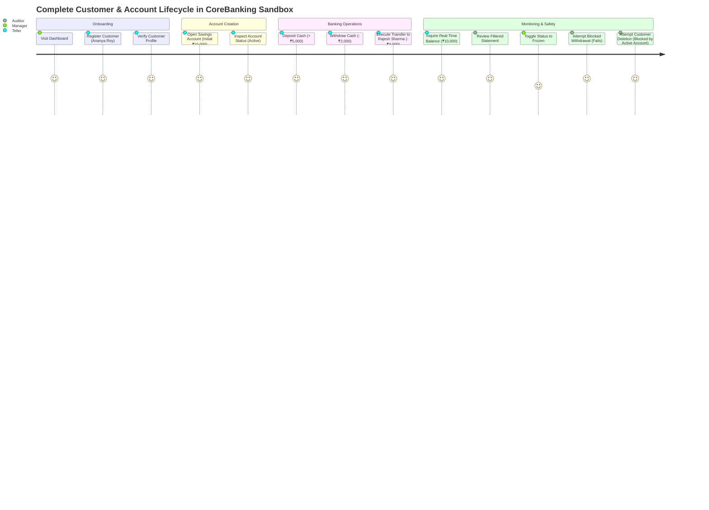

# User Flows & Demonstration Guide - CoreBanking Sandbox

> **Project ID:** PST_PD_153  
> **Target Audience:** Evaluators, Mentors, Student Developers, Demo Presenters  
> **Document Purpose:** Complete end-to-end user journeys and a 12-step scripted demonstration flow

---

## 1. User Personas

| Persona | Role | Key Objectives |
| :--- | :--- | :--- |
| **Branch Teller** | Front-desk operations | Onboard retail customers, process counter cash deposits, execute withdrawals, and look up real-time balances. |
| **Operations Manager** | Banking supervision | Monitor dashboard liquidity metrics, review audit logs, and freeze accounts suspected of irregularity. |
| **Auditor / Evaluator** | Compliance & Review | Verify system invariants (e.g. non-negative balance, orphan customer protection, transaction atomicity). |

---

## 2. Complete End-to-End User Journey (Life of a Customer)



---

## 3. Step-by-Step Scripted Demo Walkthrough (12 Steps)

This scripted walkthrough covers every core feature of CoreBanking Sandbox, proving system invariants, UI responsiveness, and data consistency.

---

### Step 1: Start Application

**Action:**
1. Open terminal 1 and start the backend service:
   ```bash
   cd backend
   npm run dev
   ```
   *Expected Console Output:*
   ```text
   [Server] CoreBanking Sandbox API running on port 5000
   [Store] Initialized seed data: 3 customers, 4 accounts, 6 transactions
   ```
2. Open terminal 2 and start the frontend client:
   ```bash
   cd frontend
   npm run dev
   ```
3. Open a browser and visit `https://corebanking-sandbox.onrender.com` (or locally at `http://localhost:3000`).

---

### Step 2: View Dashboard

**Action:** Navigate to `https://corebanking-sandbox.onrender.com/` (or local port) or click **Dashboard** in the sidebar.

**What You See:**
- **Metric Card 1:** Total Customers = `3` (Rajesh Sharma, Priya Patel, Amit Verma)
- **Metric Card 2:** Total Accounts = `4` (3 Savings, 1 Current)
- **Metric Card 3:** Total Balance = `₹2,70,000.00`
- **Metric Card 4:** Total Transactions = `6`
- **Account Distribution:** Visual breakdown of Savings (75%) vs Current (25%) accounts.
- **Recent Transactions Feed:** Lists the latest transactions with timestamps and amount tags.

**Behind the Scenes:**
- HTTP Request: `GET /api/dashboard`
- Returns unified metrics computed across all stores.

---

### Step 3: Create a New Customer

**Action:**
1. Click **Customers** in the navigation bar.
2. Click the **"+ Add Customer"** button in the top right.
3. Complete the modal form with the following values:
   - **First Name:** `Ananya`
   - **Last Name:** `Roy`
   - **Email:** `ananya.roy@example.com`
   - **Phone:** `+91 98220 11223`
   - **Address:** `12 Brigade Road, Bengaluru`
   - **Date of Birth:** `1995-04-12`
4. Click **"Submit"**.

**Expected Result:**
- Success toast notification: *"Customer created successfully"*.
- The new customer appears in the customer table with ID `CUST-1004`.
- The total customer count on the dashboard increments to `4`.

**Behind the Scenes:**
- HTTP Request: `POST /api/customers`
- Response: `201 Created` with customer payload.

---

### Step 4: Open a Savings Account for New Customer

**Action:**
1. Click **Accounts** in the navigation sidebar.
2. Click **"+ Open Account"**.
3. Fill out the account opening form:
   - **Customer:** Select `Ananya Roy (CUST-1004)` from dropdown.
   - **Account Type:** Select `Savings`.
   - **Initial Deposit:** `₹20,000`.
4. Click **"Confirm & Open"**.

**Expected Result:**
- Success toast: *"Account opened successfully"*.
- New account `ACC-2005` is displayed with:
  - Account Type: `Savings`
  - Balance: `₹20,000.00`
  - Status: `active`
- Note that an opening `DEPOSIT` transaction is automatically booked in the transaction ledger.

**Behind the Scenes:**
- HTTP Request: `POST /api/accounts` with `{ customerId: "CUST-1004", accountType: "savings", initialDeposit: 20000 }`.

---

### Step 5: Make a Deposit

**Action:**
1. Navigate to **Transactions** -> Click **"New Transaction"** (or use quick action on account card).
2. Select transaction tab: **Deposit**.
3. Choose Account: `ACC-2005 (Ananya Roy)`.
4. Enter Amount: `₹10,000`.
5. Enter Description: `Client consulting advance`.
6. Click **"Process Deposit"**.

**Expected Result:**
- Success banner: *"Deposit of ₹10,000 processed successfully"*.
- Account `ACC-2005` updated balance reflects `₹30,000.00`.
- Dashboard total bank balance increases by `₹10,000.00`.

**Behind the Scenes:**
- HTTP Request: `POST /api/transactions/deposit` with `{ accountId: "ACC-2005", amount: 10000, description: "Client consulting advance" }`.

---

### Step 6: Make a Withdrawal

**Action:**
1. Click **"New Transaction"** -> Select tab **Withdraw**.
2. Choose Account: `ACC-2005 (Ananya Roy)`.
3. Enter Amount: `₹5,000`.
4. Enter Description: `ATM Cash Withdrawal`.
5. Click **"Process Withdrawal"**.

**Expected Result:**
- Success banner: *"Withdrawal of ₹5,000 processed successfully"*.
- Account `ACC-2005` balance drops from ₹30,000.00 to `₹25,000.00`.
- Try edge case immediately: Attempt to withdraw `₹50,000` from `ACC-2005`.
  - Result: Form displays error toast: *"Insufficient balance in account"*. No funds deducted.

**Behind the Scenes:**
- HTTP Request: `POST /api/transactions/withdraw` with `{ accountId: "ACC-2005", amount: 5000, description: "ATM Cash Withdrawal" }`.

---

### Step 7: Open Another Account for a Different Customer

**Action:**
1. Navigate to **Accounts** -> Click **"+ Open Account"**.
2. Fill details:
   - **Customer:** Select existing customer `Amit Verma (CUST-1003)`.
   - **Account Type:** Select `Current`.
   - **Initial Deposit:** `₹50,000`.
3. Click **"Confirm & Open"**.

**Expected Result:**
- New account `ACC-2006` is created for Amit Verma.
- Status is `active`, balance is `₹50,000.00`.
- Demonstrates that a single customer can hold multiple accounts of different types.

---

### Step 8: Transfer Funds Between Accounts

**Action:**
1. Navigate to **Transactions** -> Click **"New Transaction"** -> Select tab **Transfer**.
2. Complete transfer details:
   - **Source Account (From):** `ACC-2005 (Ananya Roy, Balance: ₹25,000)`
   - **Destination Account (To):** `ACC-2001 (Rajesh Sharma, Initial Balance: ₹50,000)`
   - **Transfer Amount:** `₹15,000`
   - **Description:** `Monthly Rent Payment`
3. Click **"Execute Transfer"**.

**Expected Result:**
- Success dialog: *"Transfer of ₹15,000 completed successfully"*.
- Verified Ledger Balances:
  - `ACC-2005` balance is now `₹10,000.00` (₹25,000 - ₹15,000).
  - `ACC-2001` balance is now `₹65,000.00` (₹50,000 + ₹15,000).
  - Net bank liquidity remains perfectly invariant (no money created or lost).

**Behind the Scenes:**
- HTTP Request: `POST /api/transactions/transfer` with `{ fromAccountId: "ACC-2005", toAccountId: "ACC-2001", amount: 15000, description: "Monthly Rent Payment" }`.

---

### Step 9: View Transaction History

**Action:**
1. Click **Transaction History** in the navigation bar.
2. Review the paginated ledger.
3. Test Filters:
   - Filter by **Type:** Select `TRANSFER` -> only transfers appear.
   - Filter by **Account ID:** Enter `ACC-2005` -> all deposits, withdrawals, and transfers for Ananya's account are shown in chronological order.
4. Verify that each record displays:
   - Transaction ID (`TXN-XXXX`)
   - Type badge with distinctive coloring
   - Formatted timestamp
   - Net balance after transaction
   - Transaction memo/description

---

### Step 10: Check Account Balance (Balance Inquiry)

**Action:**
1. Click **Balance Inquiry** from the navigation menu.
2. Select or type `ACC-2005` in the account lookup input.
3. Click **"Check Balance"**.

**Expected Result:**
- Instant lookup card renders:
  - Account ID: `ACC-2005`
  - Account Holder: `Ananya Roy`
  - Account Type: `Savings`
  - Available Balance: `₹10,000.00`
  - Status: `Active` (Green badge)
  - Currency: `INR (₹)`

**Behind the Scenes:**
- HTTP Request: `GET /api/accounts/ACC-2005/balance`

---

### Step 11: Change Account Status

**Action:**
1. Navigate back to **Accounts**.
2. Locate `ACC-2005 (Ananya Roy)`.
3. In the Actions column, click the **Status** selector / menu and choose **Frozen**.
4. Confirm status change in prompt.

**Expected Result:**
- Account badge changes to **Frozen** (Red indicator).
- Test restriction: Try to execute a deposit of ₹1,000 into `ACC-2005`.
  - Result: Blocked! API returns: *"Account is frozen. Transactions cannot be processed"*.
5. Switch status back to **Active** (Green indicator) to restore operational state.

**Behind the Scenes:**
- HTTP Request: `PATCH /api/accounts/ACC-2005/status` with `{ status: "frozen" }`.

---

### Step 12: Delete a Customer (Safety Invariant Demonstration)

**Action:**
1. Navigate to **Customers**.
2. Locate `Rajesh Sharma (CUST-1001)`, who owns active accounts (`ACC-2001`, `ACC-2002`).
3. Click the **Delete** (Trash) icon next to Rajesh Sharma.
4. Confirm deletion dialog.

**Expected Result:**
- Operation is **safely rejected**!
- Error Banner: *"Cannot delete customer: Customer has active accounts (ACC-2001, ACC-2002). Close or reassign accounts first."*
- Proves that the core banking invariants prevent orphaned financial accounts.

5. *Optional positive delete test:*
   - Create a temporary customer (e.g. `Test Orphan`) without opening any accounts.
   - Click delete -> Customer is removed cleanly.

---

## 4. Summary Matrix of Demonstration Steps

| Step | Feature | Input / Parameters | Expected Outcome |
| :---: | :--- | :--- | :--- |
| **1** | Boot | `npm run dev` in both dirs | Servers active on `:5000` & `:5173` |
| **2** | Dashboard | View `/dashboard` | Metrics match initial seed data |
| **3** | Customer CRUD | Create Ananya Roy | Customer `CUST-1004` persisted |
| **4** | Account Open | Open Savings for Ananya, ₹20k | Account `ACC-2005` created |
| **5** | Deposit | +₹10,000 into `ACC-2005` | Balance reflects ₹30,000.00 |
| **6** | Withdrawal | -₹5,000 from `ACC-2005` | Balance reflects ₹25,000.00 |
| **7** | Account Open 2 | Open Current for Amit, ₹50k | Account `ACC-2006` created |
| **8** | Fund Transfer | Transfer ₹15k: `ACC-2005` -> `ACC-2001` | Balances updated atomically |
| **9** | Audit Ledger | Filter by `TRANSFER` & `ACC-2005` | Filtered ledger displays audit trail |
| **10** | Balance Inquiry | Lookup `ACC-2005` | Displays ₹10,000.00 active |
| **11** | Status Guard | Change `ACC-2005` to `frozen` | Subsequent transactions rejected |
| **12** | Safety Invariant | Attempt to delete `CUST-1001` | Rejected: Customer has active accounts |
